<p align="center">
  
</p>

<h1 align="center">Coldboot</h1>

<p align="center">
  A virtual machine and PC emulator for Windows. Modern PCs run on the Windows Hypervisor Platform with a chipset, disk, USB, network and sound hardware, a BIOS, a UEFI firmware and ACPI tables written from scratch. The IBM PC/XT runs on a cycle-counted 8088 of its own. One exe under 1 MB, no installer, no kernel drivers, and nothing links against the C runtime.
</p>

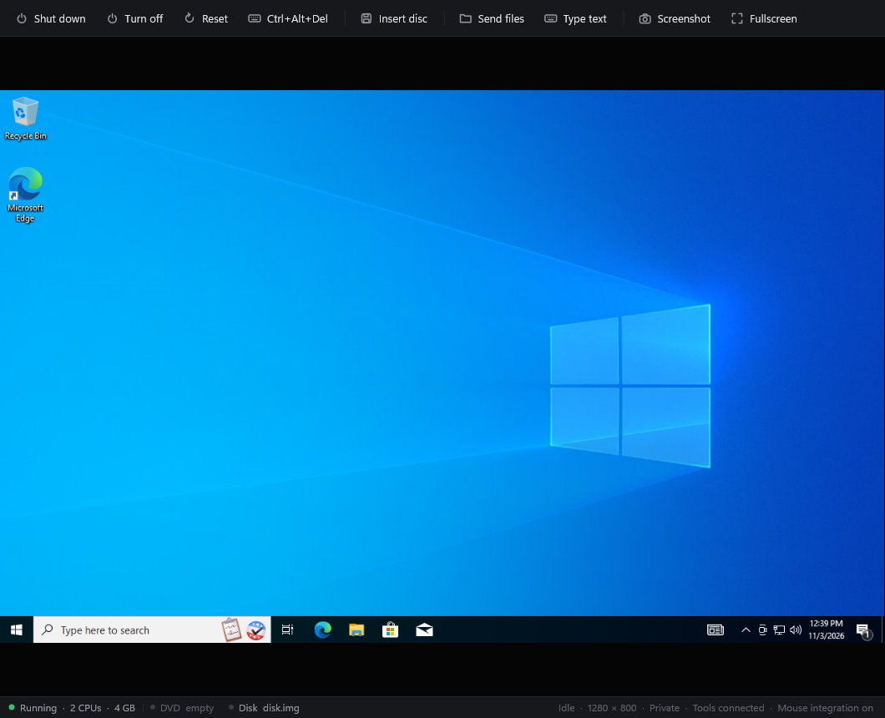

## See it

| Ask first | Send files |
|---|---|
| 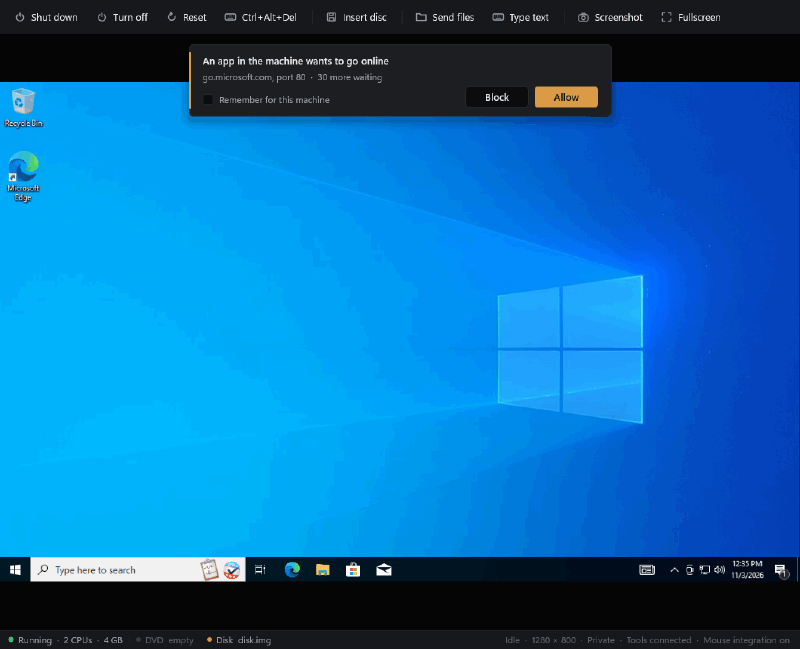 | 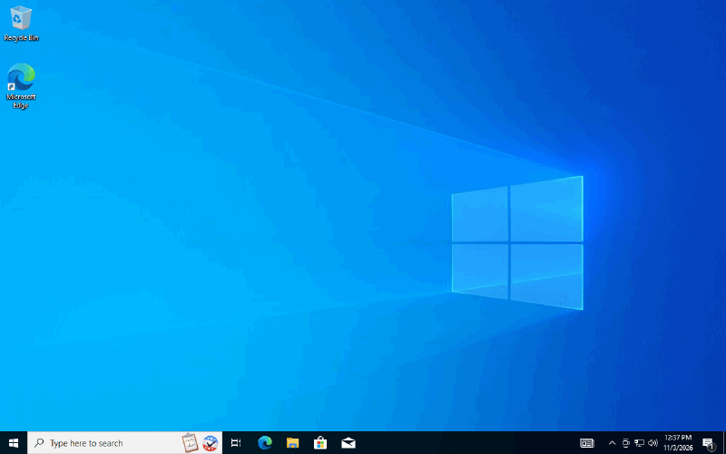 |
| A machine set to Ask first holds every new connection until you answer. Coldboot Tools names the app inside Windows, here OneDrive and a background task right after sign-in. | **Send files** drops files and folders into `From your PC` on the guest's desktop. Copy and paste in Explorer works the same way in both directions. |

Both clips are recorded from Coldboot itself: the left one from the real window, the right one from the guest's screen.

## What's in it

### Modern PCs

A modern PC is a 64-bit machine with up to 64 processors and as much memory as you give it. Coldboot drives the hypervisor directly and handles everything the guest touches outside its own memory.

- **Hypervisor engine.** One partition per machine through the Windows Hypervisor Platform, loaded at run time. Memory above 3 GB moves past 4 GB to leave room for the PCI hole, and an optional CPU cap limits each virtual processor. Device memory and string I/O go through our own x86-64 instruction emulator and page-table walker.
- **Chipset.** Two 8259s with edge and level triggering, the 8254 timer, the RTC and CMOS, an 8042 with a PS/2 keyboard and wheel mouse, an ACPI power block with the PM timer, power button and soft off, a 16550 UART, an IOAPIC, and PCI with an i440FX host bridge and a PIIX3.
- **Storage.** A PIIX3 IDE controller with an ATA hard disk (PIO, LBA48 and bus-master DMA) and two ATAPI DVD drives that answer the MMC commands Windows and Linux CD drivers send. Disks are raw images or fixed VHDs, and new ones are sparse files.
- **Display.** VGA text, CGA, mode 13h and the 16-color planar modes (0Dh to 12h, with all four write modes, latches and both read modes), plus 29 VESA linear framebuffer modes from 640 × 400 up to 2560 × 1600, with an EDID that names the machine's chosen resolution as the monitor's native mode.
- **USB and an absolute pointer.** A PIIX3 UHCI controller that walks the guest's frame list, queue heads and transfer descriptors every millisecond, with a USB HID tablet on its first port. Once the guest's driver is polling it, the pointer moves in and out of the screen freely and clicks land exactly where you point, with no capture.
- **Network.** An Intel PRO/1000 MT (82540EM) with its EEPROM over EERD and Microwire, the PHY over MDIC, descriptor rings, checksum offload and TCP segmentation offload. Behind it sits a NAT of our own: DHCP hands out 10.0.2.15, 10.0.2.3 relays DNS to your PC's resolver, TCP and UDP go out through ordinary host sockets, pings are answered, and 10.0.2.2 reaches your PC itself.
- **Sound.** An Intel HD Audio controller with CORB and RIRB, the immediate command interface, eight stream engines, buffer descriptor lists and the position buffer, plus a codec of our own with a DAC, a speaker pin and volume control. Playback is resampled into your default speakers through WASAPI.
- **UEFI.** A 64-bit firmware whose boot and runtime services run in C++ on the host behind one I/O port, with tiny stubs in the guest. It has a memory map and page and pool allocators, events and timers, a handle and protocol database, a PE loader with relocations, StartImage and Exit, GOP graphics, text in and out, block and disk I/O over GPT, MBR and El Torito partitions, a FAT reader for the EFI system partition, persistent variables, ExitBootServices and SetVirtualAddressMap. Windows' own `cdboot.efi`, boot manager and `winload.efi` run on it, and it answers Windows' "Press any key to boot from CD or DVD" for you when the hard disk is still empty.
- **BIOS.** The services live in C++ behind a single I/O port, with small real-mode stubs built by Coldboot's own assembler. Because the stubs only do port I/O, they also work when Windows calls the video BIOS from its kernel. It covers INT 10h with VBE 3.0 and DDC, INT 13h with EDD and El Torito CD boot, INT 15h with the E820 memory map, INT 16h, INT 1Ah with the PCI BIOS, and the PS/2 mouse services.
- **ACPI and SMBIOS.** RSDP, RSDT, XSDT, FADT, FACS and MADT, and a DSDT written by Coldboot's own AML encoder, with the PCI root bridge, interrupt routing, ISA devices and sleep states. SMBIOS 2.8 describes the BIOS, the system with a per-machine UUID, the processors and the memory.

On top of the hardware:

- **Hands-free Windows setup.** Pick **Automatic** in the New dialog, type a user name and an optional password, and Coldboot writes a small second disc with an `autounattend.xml`. Setup wipes and partitions the virtual disk for BIOS or UEFI, picks the edition, skips the product key, license, account and privacy screens, makes your user an administrator, signs in once and installs Coldboot Tools. The setup language comes from the ISO, read with our own ISO 9660 and UDF reader. Windows 11 also gets its TPM, Secure Boot, memory, processor and forced network checks skipped. Your ISO is never changed.
- **Coldboot Tools.** The Coldboot exe doubles as the guest tools, with no drivers inside the guest. It starts at sign-in and talks to the host at an address that only exists inside Coldboot's NAT. It shares text and files through the clipboard (copy a file in Explorer on your PC, paste it in Explorer in the machine, and back), receives sent files, sets the machine's resolution, and tells the host which app owns a connection. The host enforces each machine's sharing rules, so a guest can't pull anything you didn't allow.
- **Smooth display.** The window paces itself to your monitor through a waitable swap chain, or to a cap of 30 to 144 frames per second on a high-resolution timer. It only uploads the guest screen to the GPU when a pixel changed, and draws nothing at all while everything is still. Scaling is fit, whole steps or actual size, with a sharp or smooth filter and an optional frame counter.
- **Privacy, all off until you turn it on.** Each machine can:
  - ask before any app goes online. One answer covers that app's waiting connections, and "Remember" keeps it for the machine.
  - keep away from your PC and your local network.
  - send everything through a SOCKS5 proxy such as Tor. Names are answered with placeholder addresses so they reach the proxy instead of a resolver, and other UDP is dropped rather than leaked. If the proxy can't be reached, nothing gets out.
  - get a fresh MAC address and system UUID on every start.
  - forget every disk change when it shuts down. Writes go to a scratch file encrypted with ChaCha20 under a key that only exists in memory, and the disk image is never written.
  - leave no screen preview behind.

What it runs today: Windows 10 installs from its ISO with no questions asked, on the BIOS or on UEFI with GPT, in under ten minutes. Windows finds the disk, the DVD drives, the tablet, the network card and the sound card with the drivers it already has, browses the web, plays sound, shares the clipboard and files with your PC, and shuts the machine off cleanly through ACPI. The FreeDOS 1.4 live CD boots, and its installer installs FreeDOS onto a virtual disk that then boots on its own.

Not there yet: snapshots and save states for modern PCs, TPM and Secure Boot, AHCI and NVMe disks, port forwarding, microphone input, 3D acceleration, a guest screen that follows the window size, and tested Linux guests.

| | |
|---|---|
| 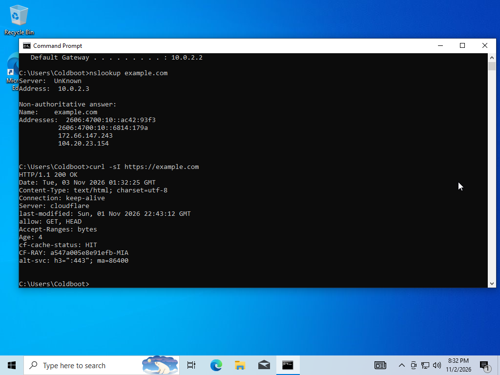 | 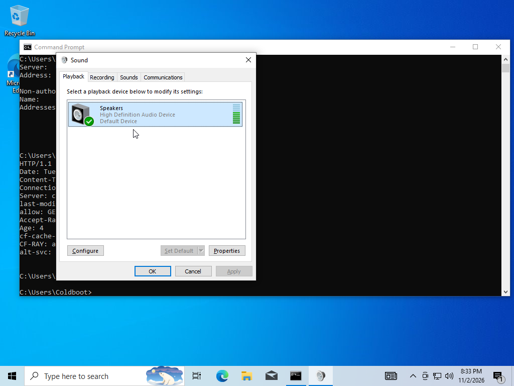 |

### IBM PC/XT

The XT powers on into its own BIOS, which it assembles from source every time the machine starts. Drop a floppy image on the window and it boots. FreeDOS 1.3 runs on it, installer and all.

- **8088.** Every opcode, including the undocumented ones. Passes all 3,007,000 cases in [SingleStepTests 8088](https://github.com/SingleStepTests/8088), undefined flags included, and counts clocks with a prefetch queue model.
- **Board.** 8259, 8253, 8237 with DRAM refresh, 8255 with the configuration switches, the XT keyboard, the PC speaker, and CGA in all of its text and graphics modes.
- **Floppies.** An NEC 765 on DMA channel 2 and IRQ 6 with two drives and images from 160 KB to 1.44 MB. Writes go back to the image file when the drive motor stops.
- **BIOS.** About 3,100 lines of 8086 assembly in [`src/firmware`](src/firmware). POST with a memory count you can watch, a boot menu, INT 10h video for every CGA mode, the keyboard with every shift and lock key, INT 13h with media detection, the timer, and the IBM entry points at their fixed addresses.
- **Assembler.** A two-pass 8086 assembler with labels, local labels, `equ`, `org`, `times`, `incbin` and automatic short and near jumps. It builds both BIOSes, the boot sector of every blank disk Coldboot makes, and any program you drop on the window.
- **Boot your own code.** Drop an `.asm` file on the window and Coldboot assembles it onto a 360 KB disk and reboots into it. Save the file and it rebuilds and reboots again, or shows the line it broke on and keeps the old build running. [`demos/mandelbrot.asm`](demos/mandelbrot.asm) draws the Mandelbrot set in CGA with 4.12 fixed point math in a single 512 byte boot sector, and takes about a minute at 4.77 MHz.
- **Save states.** The whole machine, disks included, in one file.
- **Display.** Direct3D 11 with sharp scaling to 4:3, or a CRT mode with curvature, scanlines and a phosphor mask.

| | |
|---|---|
|  |  |
|  |  |


## Using it

### The machine list


- Coldboot opens on its machine list. **New** makes a machine in `Documents\Coldboot VMs`, each in its own folder with a `.coldboot` file you can copy, back up or add on another PC with **Add**.
- Drop an `.iso` on the list and Coldboot reads its volume label, picks Windows 11, Windows 10, Ubuntu, Debian, Fedora or a plain PC, and fills in the new machine with the right amount of memory, processors and disk. Drop an `.img` to make a machine around an existing hard disk, or a `.coldboot` file to add it.
- New modern machines get sliders for memory, processors and disk size that know your PC. Memory turns amber past half of what you have and red past 80%, and processors turn amber once they go beyond your physical cores. A 64 GB disk takes no space until the guest writes to it.
- A new Windows machine asks how setup should go. **Automatic** installs Windows with the user name and password you type (the name starts out as yours on this PC), and **Ask me** leaves every setup screen to you.
- **Start** (or a double click) opens the machine in its own window and process, so a crash in one machine never takes down the list or the others. **Start options** starts it with different privacy choices for that one run. The list shows which machines are running, and the last screen of each one after it closes.
- **Remove** either forgets a machine or deletes it for good, along with the hard disk in its folder. ISOs, floppies and anything else you put in the folder are left alone.

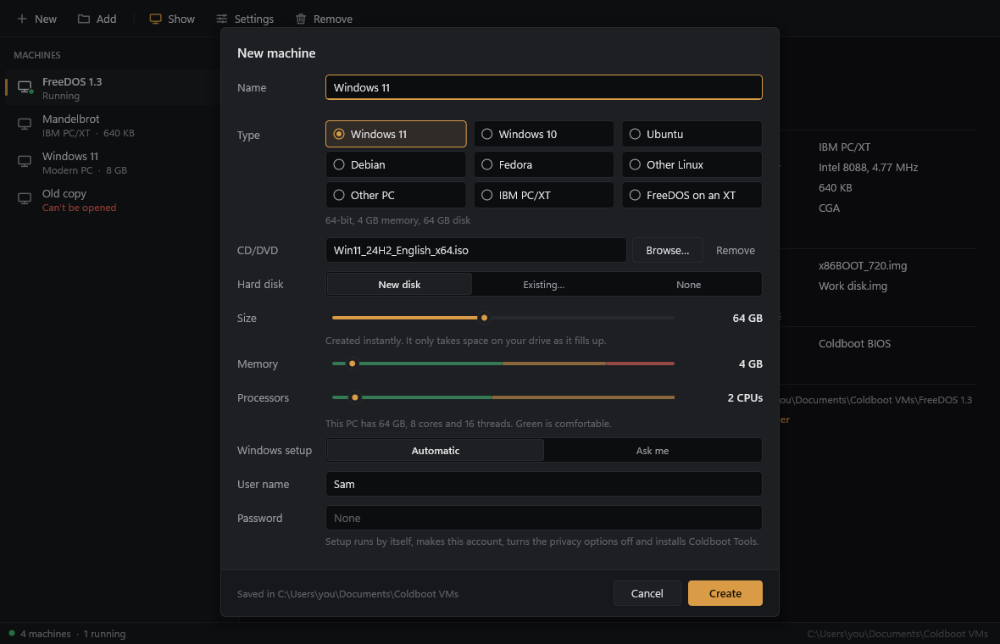

### Settings

**Settings** has General, System, Storage, Sharing, Display and Privacy pages, all editable while the machine is off. Windows 11 machines start out on UEFI, and a UEFI machine keeps its variables in `nvram.bin` next to its `.coldboot` file.

| | |
|---|---|
| 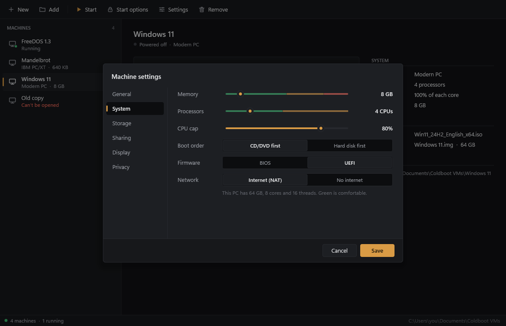 | 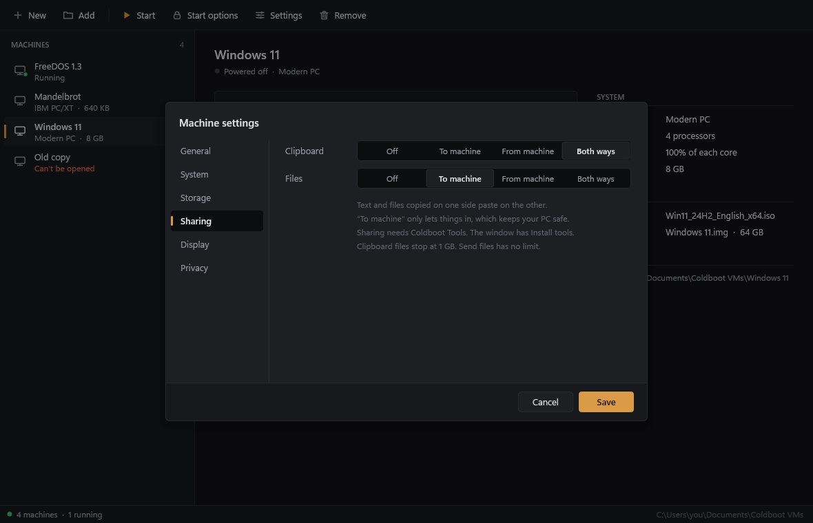 |
| 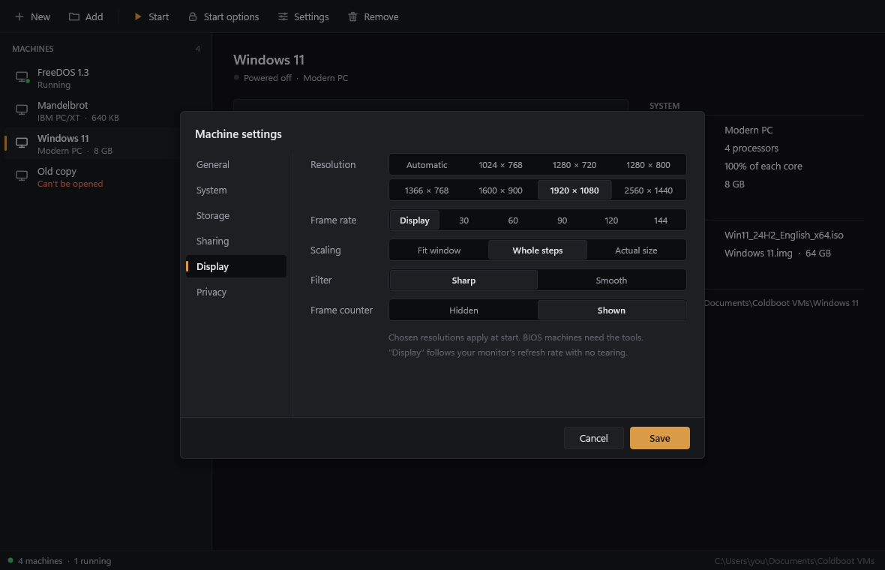 | 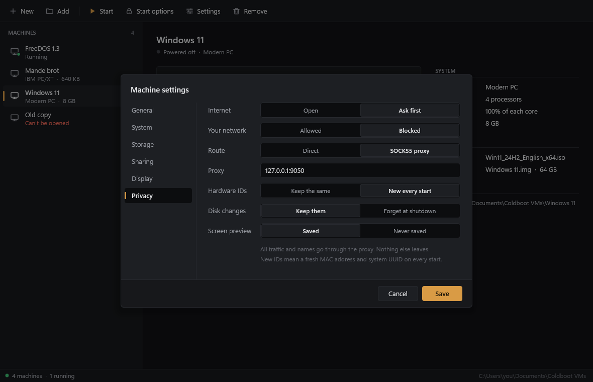 |

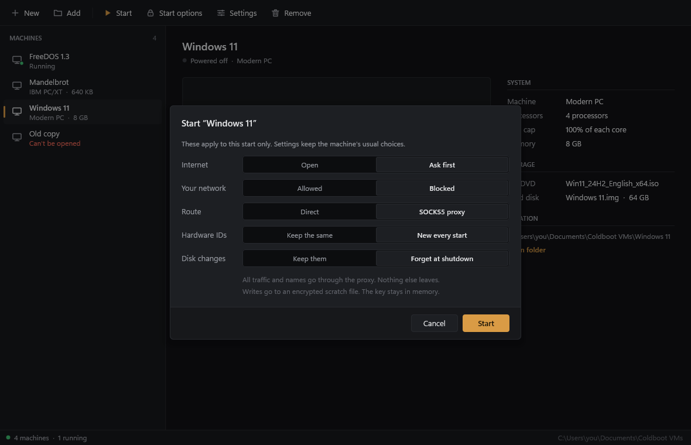

### A modern PC window

- The toolbar has **Shut down** (presses the ACPI power button so the guest can close cleanly), **Turn off**, **Reset**, **Ctrl+Alt+Del**, **Insert disc** or **Change disc**, **Eject**, **Send files**, **Type text**, **Install tools** (until the tools connect), **Screenshot** and **Fullscreen**. A narrow window folds it down to icons.
- **Send files** copies files to `From your PC` on the guest's desktop through Coldboot Tools, or puts them on a disc in the second DVD drive when the tools aren't running. Dropping files on the window does the same, and dropping an `.iso` inserts it. **Type text** types your clipboard into the guest as key presses, for screens where pasting can't work yet.
- **Install tools** puts Coldboot Tools on a disc. Running it inside Windows installs it for that user, or updates an older copy in place.
- The keyboard goes to the guest while the window has focus. Once the guest's USB tablet driver is running, the mouse just works over the screen with no capture, and the status bar says "Mouse integration on". Before that, click the screen to capture the mouse, along with keys like Alt+Tab and the Windows key. Right Ctrl lets go.
- With Ask first on, a card at the top of the screen names the app and where it wants to go, with **Block**, **Allow** and "Remember for this machine". Remembered answers live in `network-rules.txt` next to the machine. Apps give up after about 20 seconds without an answer.
- Guest sound plays through your default speakers.
- Right Ctrl+F switches fullscreen, Right Ctrl+Delete sends Ctrl+Alt+Del and Right Ctrl+S saves a screenshot to `Pictures\Coldboot`.
- The status bar shows the processors and memory, the DVD and hard disk with their activity lights, the frame counter when it's on, the screen resolution, "Private" while any privacy option is on, and whether the tools are connected.

### An XT window

- A machine window starts powered on. Drop a floppy image anywhere on it to put it in drive A, or hold Shift for drive B.
- Drop an `.asm` file the same way to boot it. Programs start at `org 0x7C00`, and anything that fits in one sector gets its boot signature added for you. A key press in the Mandelbrot demo cycles the CGA palettes.
- Press Esc while POST shows the hint to pick the boot drive.
- Click the screen to capture the keyboard, so Alt+Tab and the Windows key stay inside. Right Ctrl lets go.
- F11 is fullscreen, F12 saves a screenshot to `Pictures\Coldboot`, and Pause stops the clock.
- The pill next to the floppy button switches between a real 4.77 MHz and turbo, which runs as fast as your CPU allows.
- The floppy panel inserts, ejects and write-protects disks, and makes blank FAT12 disks from 360 KB to 1.44 MB.
- Settings cover speed, sharp or CRT display, a theme that follows Windows or stays dark or light, real or fast floppy timing, memory size, and Coldboot's BIOS or a ROM of your own.

### Trying it

- **Windows:** drop a Windows 10 or 11 ISO on the machine list, keep setup on **Automatic**, type a user name and press Create, then Start.
- **The XT:** get the [FreeDOS 1.3 Floppy Edition](https://www.freedos.org/download/) and drop `x86BOOT.img` from the `720k` folder on an XT window, or drop [`demos/mandelbrot.asm`](demos/mandelbrot.asm).

Modern PCs need the Windows Hypervisor Platform, which works on Windows Home too. Turn it on in **Turn Windows features on or off**, then restart.

## Building

Needs Visual Studio 2022 with the C++ desktop workload and the Clang tools. Open `coldboot.sln` and build x64, or run:

```
msbuild coldboot.sln -p:Configuration=Release -p:Platform=x64
```

The exe ends up in `build\release`.

## Testing

Debug builds have extra modes, and none of them show a window.

```
Coldboot.exe --test
Coldboot.exe --cpu <folder with the 8088 v2 .json.gz files>
Coldboot.exe --own [--a <image>] [--b <image>] <steps>
Coldboot.exe --pc <folder> [--iso <file>] [--disk <file> [--create-disk <GB>]] [--disk-first] [--uefi [--variables <file>]] [--no-network] [--no-lan] [--proxy <host:port>] [--ask] [--fresh-identity] [--disposable] [--screen <W>x<H>] [--unattend <user> [--password <text>]] [--memory <MB>] [--cpus <n>] [--seconds <n>] [--every <n>] [--script <seconds> <keys>]... [--control <file>] [--record <gif> [--record-every <ms>] [--record-from <s>] [--record-speed <x>] [--record-size <W>x<H>]]
Coldboot.exe --make-iso <file> <folder> [--boot <path>] [--boot-sectors <n>] [--label <name>]
Coldboot.exe --smoke <folder> [<image> | --vm <machine file>] [--smoke-record <gif or png> <seconds> [<from>]]
Coldboot.exe --smoke-manager <folder>
```

- `--test` runs 195 checks across the CPU, the chips, the floppy controller, the assembler, disk images, the BIOS, save states, the x86-64 instruction emulator, the hypervisor engine, the modern PC chipset, the AML encoder, ACPI and SMBIOS tables, the IDE and ATAPI controller, the UHCI controller and USB tablet, the HD Audio controller and codec, the e1000 (EEPROM, rings, TSO), the NAT (ARP, DHCP, ping and a real TCP connection through a host socket), LAN blocking, Ask first, a SOCKS5 round trip through a fake proxy, the guest tools protocol and its sharing rules, the setup answers and language detection, the disposable disk, the EDID, the display and privacy settings, the GIF recorder (decoded back by Windows), the PE loader, the FAT reader, a UEFI boot of a hand-built EFI program from a GPT disk, and ISOs from the ISO builder booting end to end. The hypervisor checks are skipped on PCs without the Windows Hypervisor Platform.
- `--cpu` runs SingleStepTests. It also takes `--only <prefix>`, `--exact` and `--timing`.
- `--own` boots the XT BIOS and works through the steps in order. `--a` and `--b` take `.asm` files too:
  - `--run <seconds>` runs emulated time
  - `--type <text>` types on the keyboard, where `\n` is Enter, and `--key <hex>` presses one scan code
  - `--print` writes the text screen to the console and `--shot <png>` saves it as an image
  - `--ui <png>` renders the whole app offscreen, with `--ui-light`, `--ui-crt` and `--ui-panel disks` or `settings` to pick the look
  - `--manager <png>` renders the machine list, with `--manager-sheet new`, `image`, `settings`, `system`, `sharing`, `display`, `privacy`, `launch` or `remove`, and `--manager-empty`
  - `--console <png>` renders a modern PC window with an Ask first card
  - `--where`, `--hunt` and `--trail` show where the CPU is and catch it running into empty memory
  - `--asm` assembles the BIOS and reports errors as `file.asm:line`
- `--pc` boots a modern PC from an ISO or disk image without a window. It saves the screen every `--every` seconds and at the end, and prints where the processor is, the firmware's log, the guest's port E9 output, the IDE commands it saw, and the network, USB and sound counters.
  - `--script` types keys at a given second, where `\n` is Enter, `\t` Tab, `\e` Esc, `\b` Backspace, `\g` the Windows key, `\R` Win+R, `\d` and `\u` the arrows and `\aX` Alt+X.
  - `--control` watches a file for lines like `keys <text>`, `click <x> <y>`, `right`, `double`, `move`, `wait <ms>`, `shot <name.png>`, `power` and `quit`. It also takes `tools`, `clip <text>`, `clipfiles <path>` and `sendfile <path>` for Coldboot Tools, and `allow`, `block`, `trust` and `stats` for Ask first.
  - `--record` writes the guest's screen to an animated GIF, with our own LZW encoder, a median-cut palette per frame and only the changed rectangle stored.
  - `--unattend` writes the setup disc for a hands-free Windows install.
- `--make-iso` builds an ISO from a folder with our ISO builder, optionally bootable with a no-emulation El Torito image.
- `--smoke` starts a machine window hidden with the sound off and your settings left alone. For an XT it boots, opens the floppy panel, saves and loads a state, and writes screenshots from the swap chain plus a short report into the folder. With `--vm` and a modern PC machine file it boots the machine, then saves a screenshot and a report. `--smoke-record` records the real window to a GIF instead, or takes one still PNG, starting `<from>` seconds in. Ask first cards are answered with Allow after a moment.
- `--smoke-manager <folder>` runs the machine list hidden against a library in that folder. It creates a modern PC with a 64 GB disk, edits it, removes and re-adds it, deletes it, checks the files on disk and the saved screen preview, and writes screenshots and a report.

The XT screenshots here came from `--own` and `--ui`. The machine list and settings came from `--manager`, the window and the Ask first clip from `--smoke-record`, and the guest screens from `--pc`.

Modern PCs never need a kernel driver. The hypervisor is the one Windows ships, and every device the guest sees is emulated in the machine's own process.