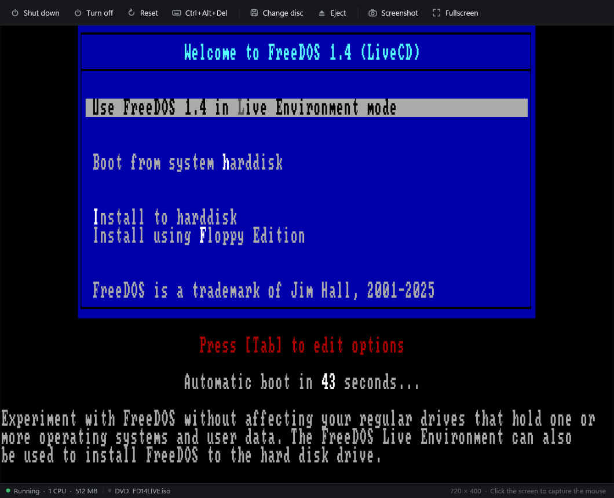
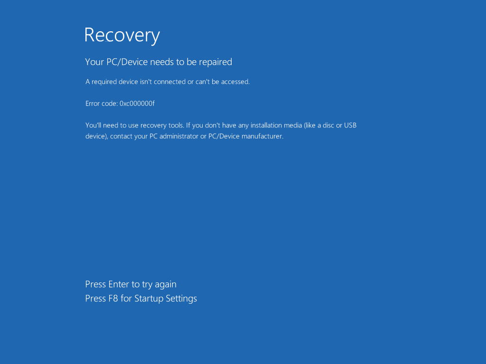

<p align="center">
  
</p>

<h1 align="center">Coldboot</h1>

<p align="center">
  A virtual machine and PC emulator for Windows. Modern PCs run on the Windows Hypervisor Platform with a chipset, disk controller, display adapter, BIOS and ACPI tables written from scratch. The IBM PC/XT runs on a cycle-counted 8088 of its own. Nothing links against the C runtime.
</p>



## What's in it

### Modern PCs

A modern PC is a 64-bit machine with up to 64 processors and as much memory as you give it. Coldboot drives the hypervisor directly and handles everything the guest touches outside its own memory.

- **Hypervisor engine.** One partition per machine through the Windows Hypervisor Platform, loaded at run time. Memory above 3 GB moves past 4 GB to leave room for the PCI hole, and an optional CPU cap limits each virtual processor. Device memory and string I/O go through our own x86-64 instruction emulator and page-table walker.
- **Chipset.** Two 8259s with edge and level triggering, the 8254 timer, the RTC and CMOS, an 8042 with a PS/2 keyboard and wheel mouse, an ACPI power block with the PM timer, power button and soft off, a 16550 UART, an IOAPIC, and PCI with an i440FX host bridge and a PIIX3.
- **Storage.** A PIIX3 IDE controller with an ATA hard disk (PIO, LBA48 and bus-master DMA) and an ATAPI DVD drive that answers the MMC commands Windows and Linux CD drivers send. Disks are raw images or fixed VHDs, and new ones are sparse files.
- **Display.** VGA text, CGA, mode 13h and the 16-color planar modes (0Dh to 12h, with all four write modes, latches and both read modes), plus 29 VESA linear framebuffer modes from 640 × 400 up to 2560 × 1600, with an EDID for the guest to read.
- **BIOS.** The services live in C++ behind a single I/O port, with small real-mode stubs built by Coldboot's own assembler. Because the stubs only do port I/O, they also work when Windows calls the video BIOS from its kernel. It covers INT 10h with VBE 3.0, INT 13h with EDD and El Torito CD boot (no-emulation and floppy emulation), INT 15h with the E820 memory map, INT 16h, INT 1Ah with the PCI BIOS, and the PS/2 mouse services.
- **ACPI and SMBIOS.** RSDP, RSDT, XSDT, FADT, FACS and MADT, and a DSDT written by Coldboot's own AML encoder, with the PCI root bridge, interrupt routing, ISA devices and sleep states. SMBIOS 2.8 describes the BIOS, the system with a stable per-machine UUID, the processors and the memory.
- **ISO builder.** An ISO 9660 writer with Joliet names and El Torito boot records, used for the Windows 11 setup helper and the tests.
- **Windows 11 on a BIOS machine.** Windows 11 machines get a small second disc with an `autounattend.xml` that skips the TPM, Secure Boot, memory and processor checks and the forced network step. Your ISO is never changed.

What it runs today: the FreeDOS 1.4 live CD boots to the prompt with its CD and mouse drivers, and its installer partitions, formats and installs FreeDOS onto a virtual disk that then boots on its own. Windows Boot Manager starts from Windows' own boot files and draws its graphical screens. A Windows Setup ISO starts the same way. Setup itself hasn't been run end to end yet.

Not there yet: networking, sound, USB, UEFI with TPM and Secure Boot, snapshots, shared folders, a shared clipboard and an absolute pointer.



### IBM PC/XT

The XT powers on into its own BIOS, which it assembles from source every time the machine starts. Drop a floppy image on the window and it boots. FreeDOS 1.3 runs on it, installer and all.

- **8088.** Every opcode, including the undocumented ones. Passes all 3,007,000 cases in [SingleStepTests 8088](https://github.com/SingleStepTests/8088), undefined flags included, and counts clocks with a prefetch queue model.
- **Board.** 8259, 8253, 8237 with DRAM refresh, 8255 with the configuration switches, the XT keyboard, the PC speaker, and CGA in all of its text and graphics modes.
- **Floppies.** An NEC 765 on DMA channel 2 and IRQ 6 with two drives and images from 160 KB to 1.44 MB. Writes go back to the image file when the drive motor stops.
- **BIOS.** About 3,100 lines of 8086 assembly in [`src/firmware`](src/firmware). POST with a memory count you can watch, a boot menu, INT 10h video for every CGA mode, the keyboard with every shift and lock key, INT 13h with media detection, the timer, and the IBM entry points at their fixed addresses.
- **Assembler.** A two-pass 8086 assembler with labels, local labels, `equ`, `org`, `times`, `incbin` and automatic short and near jumps. It builds both BIOSes, the boot sector of every blank disk Coldboot makes, and any program you drop on the window.
- **Boot your own code.** Drop an `.asm` file on the window and Coldboot assembles it onto a 360 KB disk and reboots into it. Save the file and it rebuilds and reboots again, or shows the line it broke on and keeps the old build running. [`demos/mandelbrot.asm`](demos/mandelbrot.asm) draws the Mandelbrot set in CGA with 4.12 fixed point math in a single 512 byte boot sector, and takes about a minute at 4.77 MHz.
- **Save states.** The whole machine, disks included, in one file.
- **Display.** Direct3D 11 with sharp scaling to 4:3, or a CRT mode with curvature, scanlines and a phosphor mask.


| | |
|---|---|
|  |  |
|  |  |


## Using it

### The machine list

- Coldboot opens on its machine list. **New** makes a machine in `Documents\Coldboot VMs`, each in its own folder with a `.coldboot` file you can copy, back up or add on another PC with **Add an existing machine**.
- Drop an `.iso` on the list and Coldboot reads its volume label, picks Windows 11, Windows 10, Ubuntu, Debian, Fedora or a plain PC, and fills in the new machine with the right amount of memory, processors and disk. Drop an `.img` to make a machine around an existing hard disk, or a `.coldboot` file to add it.
- New modern machines get sliders for memory, processors and disk size that know your PC. Memory turns amber past half of what you have and red past 80%, and processors turn amber once they go beyond your physical cores. A 64 GB disk takes no space until the guest writes to it.
- **Start** (or a double click) opens the machine in its own window and process, so a crash in one machine never takes down the list or the others. The list shows which machines are running, and the last screen of each one after it closes.
- **Settings** has General, System and Storage pages for the name, memory, processors, a CPU cap, the boot order, the ISO, the hard disk, floppies and BIOS, all editable while a machine is off. **Remove** either forgets a machine or deletes it for good, along with the hard disk in its folder. ISOs, floppies and anything else you put in the folder are left alone.

### A modern PC window

- The toolbar has **Shut down** (presses the ACPI power button so the guest can close cleanly), **Turn off**, **Reset**, **Ctrl+Alt+Del**, **Insert disc** or **Change disc**, **Eject**, **Screenshot** and **Fullscreen**.
- The keyboard goes to the guest while the window has focus. Click the screen to capture the mouse too, along with keys like Alt+Tab and the Windows key. Right Ctrl lets go.
- Right Ctrl+F switches fullscreen, Right Ctrl+Delete sends Ctrl+Alt+Del and Right Ctrl+S saves a screenshot to `Pictures\Coldboot`.
- The status bar shows the processors and memory, the DVD and hard disk with their activity lights, and the screen resolution.

### An XT window

- A machine window starts powered on. Drop a floppy image anywhere on it to put it in drive A, or hold Shift for drive B.
- Drop an `.asm` file the same way to boot it. Programs start at `org 0x7C00`, and anything that fits in one sector gets its boot signature added for you. A key press in the Mandelbrot demo cycles the CGA palettes.
- Press Esc while POST shows the hint to pick the boot drive.
- Click the screen to capture the keyboard, so Alt+Tab and the Windows key stay inside. Right Ctrl lets go.
- F11 is fullscreen, F12 saves a screenshot to `Pictures\Coldboot`, and Pause stops the clock.
- The pill next to the floppy button switches between a real 4.77 MHz and turbo, which runs as fast as your CPU allows.
- The floppy panel inserts, ejects and write-protects disks, and makes blank FAT12 disks from 360 KB to 1.44 MB.
- Settings cover speed, sharp or CRT display, a theme that follows Windows or stays dark or light, real or fast floppy timing, memory size, and Coldboot's BIOS or a ROM of your own.

To try the XT, get the [FreeDOS 1.3 Floppy Edition](https://www.freedos.org/download/) and drop `x86BOOT.img` from the `720k` folder on the window. To try a modern PC, drop the [FreeDOS 1.4 live CD](https://www.freedos.org/download/) on the machine list and press Start.

Modern PCs need the Windows Hypervisor Platform. Turn it on in **Turn Windows features on or off**, then restart.

## Building

Needs Visual Studio 2022 with the C++ desktop workload and the Clang tools. Open `coldboot.sln` and build x64, or run:

```
msbuild coldboot.sln -p:Configuration=Release -p:Platform=x64
```

The exe ends up in `build\release`.

## Testing

Debug builds have extra modes, and none of them show a window.

```
Coldboot.exe --test
Coldboot.exe --cpu <folder with the 8088 v2 .json.gz files>
Coldboot.exe --own [--a <image>] [--b <image>] <steps>
Coldboot.exe --pc <folder> [--iso <file>] [--disk <file>] [--memory <MB>] [--cpus <n>] [--seconds <n>] [--every <n>] [--type <text> --at <seconds>]
Coldboot.exe --make-iso <file> <folder> [--boot <path>] [--boot-sectors <n>] [--label <name>]
Coldboot.exe --smoke <folder> [<image> | --vm <machine file>]
Coldboot.exe --smoke-manager <folder>
```

- `--test` runs 165 checks across the CPU, the chips, the floppy controller, the assembler, disk images, the BIOS, save states, the x86-64 instruction emulator, the hypervisor engine, the modern PC chipset, the AML encoder, ACPI and SMBIOS tables, the IDE and ATAPI controller, and ISOs from the ISO builder booting end to end, one of them drawing in VGA mode 12h. The hypervisor checks are skipped on PCs without the Windows Hypervisor Platform.
- `--cpu` runs SingleStepTests. It also takes `--only <prefix>`, `--exact` and `--timing`.
- `--own` boots the XT BIOS and works through the steps in order. `--a` and `--b` take `.asm` files too:
  - `--run <seconds>` runs emulated time
  - `--type <text>` types on the keyboard, where `\n` is Enter, and `--key <hex>` presses one scan code
  - `--print` writes the text screen to the console and `--shot <png>` saves it as an image
  - `--ui <png>` renders the whole app offscreen, with `--ui-light`, `--ui-crt` and `--ui-panel disks` or `settings` to pick the look
  - `--where`, `--hunt` and `--trail` show where the CPU is and catch it running into empty memory
  - `--asm` assembles the BIOS and reports errors as `file.asm:line`
- `--pc` boots a modern PC from an ISO or disk image without a window, saves the screen every `--every` seconds and at the end, types `--type` text at `--at` seconds (`\n` is Enter), and prints where the processor is and anything the guest wrote to port E9.
- `--make-iso` builds an ISO from a folder with our ISO builder, optionally bootable with a no-emulation El Torito image.
- `--smoke` starts a machine window hidden with the sound off and your settings left alone. For an XT it boots, opens the floppy panel, saves and loads a state, and writes screenshots from the swap chain plus a short report into the folder. With `--vm` and a modern PC machine file it boots the machine, then saves a screenshot and a report.
- `--smoke-manager <folder>` runs the machine list hidden against a library in that folder. It creates a modern PC with a 64 GB disk, edits it, removes and re-adds it, deletes it, checks the files on disk and the saved screen preview, and writes screenshots and a report.
- `--manager <png>` (after `--own`) renders the machine list offscreen, with `--manager-sheet new`, `settings`, `remove`, `image` or `system` and `--manager-empty`.

The XT screenshots here came from `--own` and `--ui`, and the modern PC ones from `--smoke` and `--pc`.