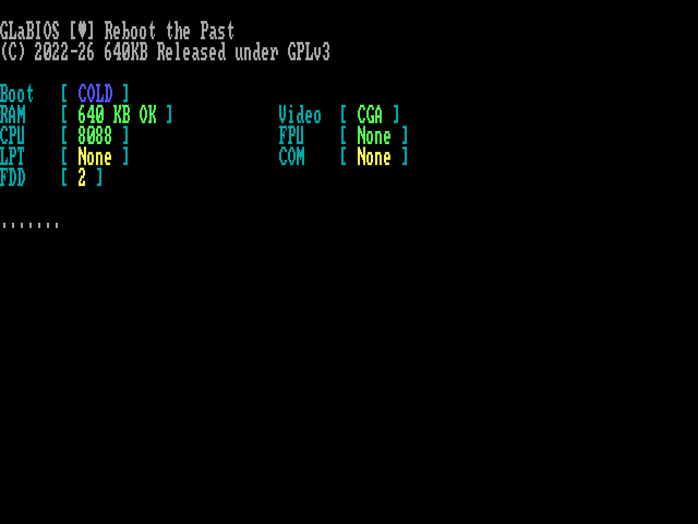
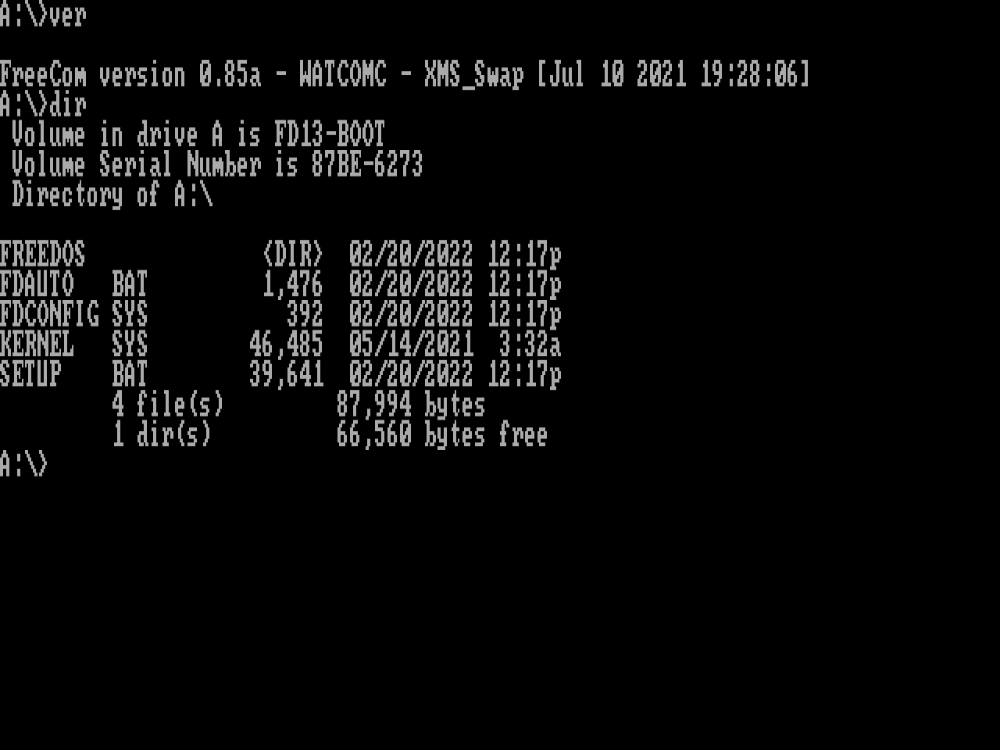

# Coldboot

x86 PC emulator for Windows. The CPU, chipset and BIOS are all written from scratch, and nothing links against the C runtime.

Right now it's an IBM PC/XT: an 8088 at 4.77 MHz, 640 KB of RAM, CGA, the keyboard, the PC speaker and two floppy drives. It boots FreeDOS from a floppy image. Coldboot's own BIOS is next, so until then you drop in a BIOS ROM to power the machine on.






## Running it

Drop a BIOS ROM of 64 KB or less onto the window and the machine powers on. Coldboot remembers the ROM for next time. Drop a floppy image to put it in drive A, or hold Shift to put it in drive B. Any image from 160 KB to 1.44 MB works. When the guest writes to a disk, Coldboot saves the changes back to the image file once the drive motor stops. If the image file is read-only, the disk is write-protected.

Files can also go on the command line, ROM and disks in any order:

```
Coldboot.exe GLABIOS_0.4.2_8X.ROM x86BOOT.img
```

To try it out, get [GLaBIOS](https://github.com/640-KB/GLaBIOS/releases) (the `8X` build) and the [FreeDOS 1.3 Floppy Edition](https://www.freedos.org/download/), then use `x86BOOT.img` from the `720k` folder. The FreeDOS 1.2 install floppy won't work: its COMMAND.COM uses 80186 instructions, so it crashes on a real 8088 too.

## Hardware

- **8088.** Runs every opcode, including the undocumented ones, and passes all 3,007,000 cases in the [SingleStepTests 8088](https://github.com/SingleStepTests/8088) suite, including the flags Intel calls undefined. Handles hardware interrupts, NMI, `hlt` and the trap flag, and counts clocks with a prefetch queue model.
- **Motherboard.** 8259 interrupt controller, 8253 timer, 8237 DMA with page registers and DRAM refresh, and 8255 with the configuration switches.
- **Keyboard.** The XT keyboard, including its reset handshake.
- **Sound.** The PC speaker, played through WASAPI.
- **CGA.** 40 and 80 column text, 320x200 and 640x200 graphics, and a code page 437 font drawn for Coldboot.
- **Floppy.** NEC 765 controller on DMA channel 2 and IRQ 6. Seek, recalibrate, read, write, format, read ID, multi-track transfers and write protection, at the real drive's data rate.

## Building

Needs Visual Studio 2022 with the C++ desktop workload and the Clang tools. Open `coldboot.sln` and build x64, or run:

```
msbuild coldboot.sln -p:Configuration=Release -p:Platform=x64
```

Everything ends up in `build\release`.

## Testing

Debug builds have three extra modes:

```
Coldboot.exe --test
Coldboot.exe --cpu <folder with the 8088 v2 .json.gz files>
Coldboot.exe --bios <rom> [--a <image>] [--b <image>] <steps>
```

`--test` checks the CPU, every chip, the floppy controller and a full boot from a generated disk. `--cpu` also takes `--only <prefix>` to run some opcodes, `--exact` to check undefined flags too, and `--timing` to compare clock counts with the hardware recordings.

The third mode runs the machine without a window and works through the steps in order:

- `--run <seconds>`: run the machine for that much emulated time
- `--type <text>`: type on the keyboard, where `\n` is Enter
- `--key <scan code>`: press a single key by its hex scan code
- `--print`: write the text screen to the console
- `--shot <file.png>`: save the screen as a 4:3 PNG
- `--where`: print where the CPU is, plus the interrupt controller and floppy controller state
- `--hunt <seconds>`: single-step until execution leaves RAM and ROM, then print the last 48 instructions

The FreeDOS prompt screenshot above came from:

```
Coldboot.exe --bios GLABIOS_0.4.2_8X.ROM --a x86BOOT.img --run 150 --type "n\n" --run 60 --type "cls\n" --run 4 --type "ver\n" --run 4 --type "dir\n" --run 25 --shot prompt.png
```