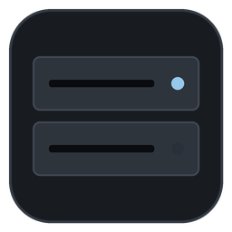
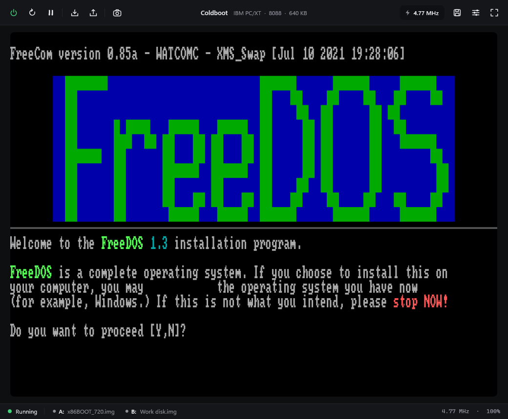
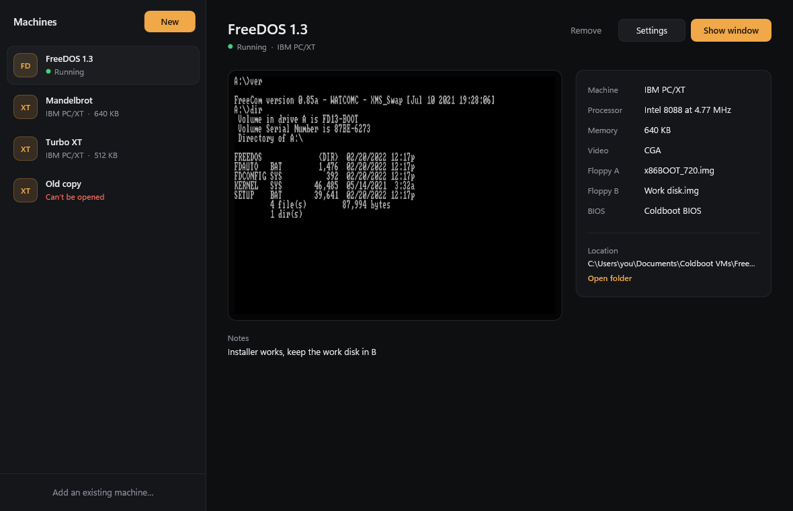
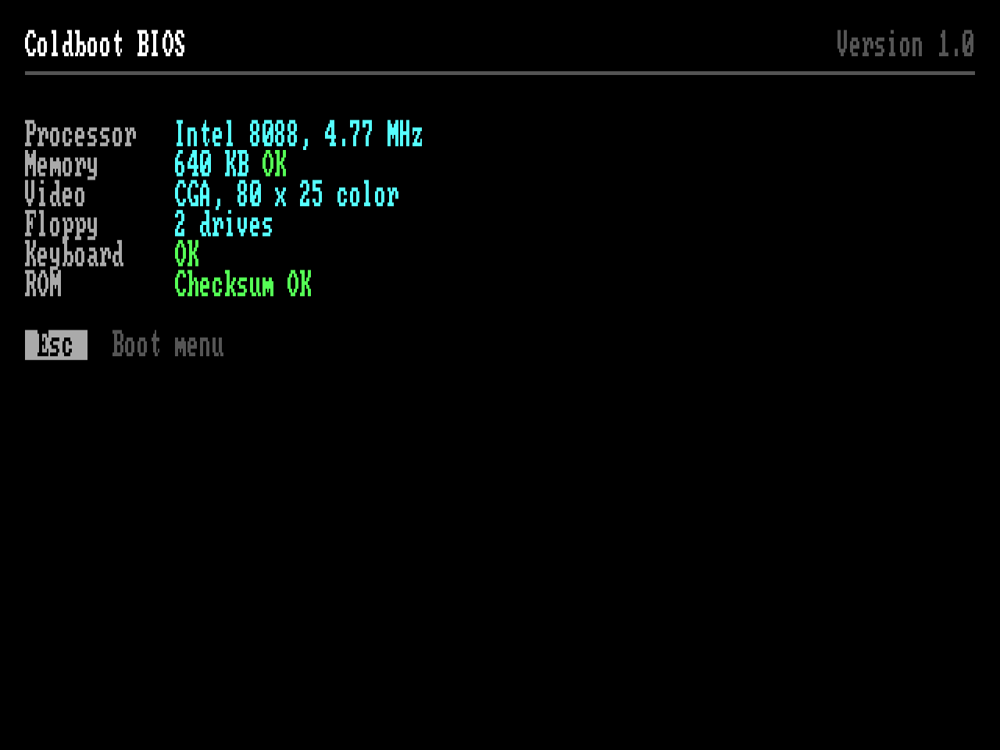
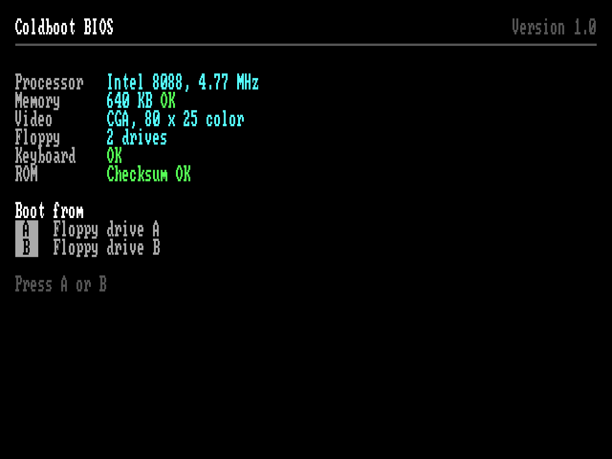
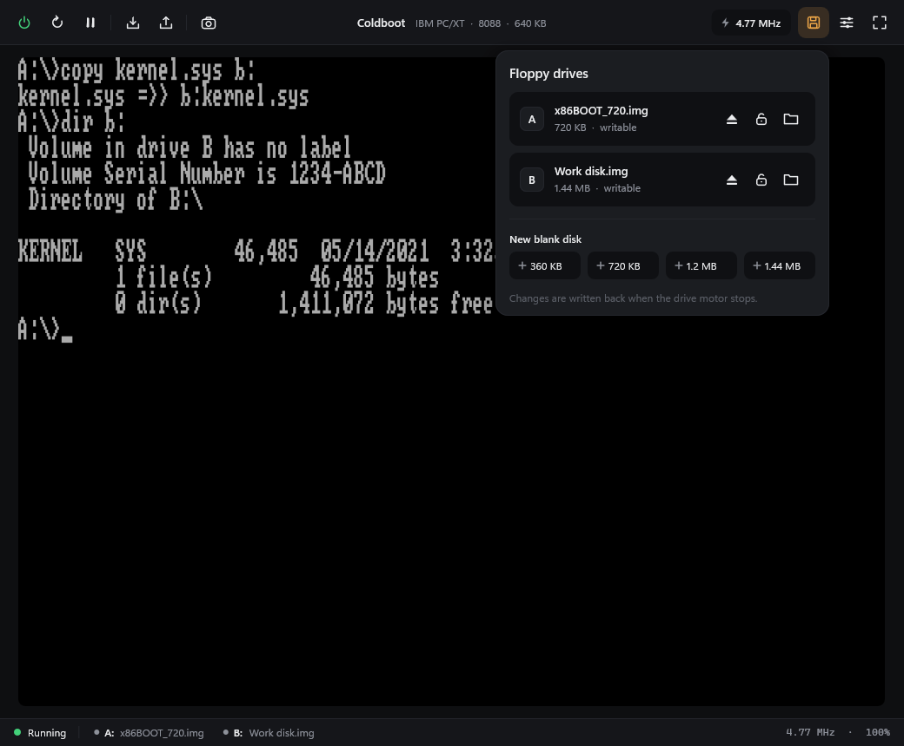
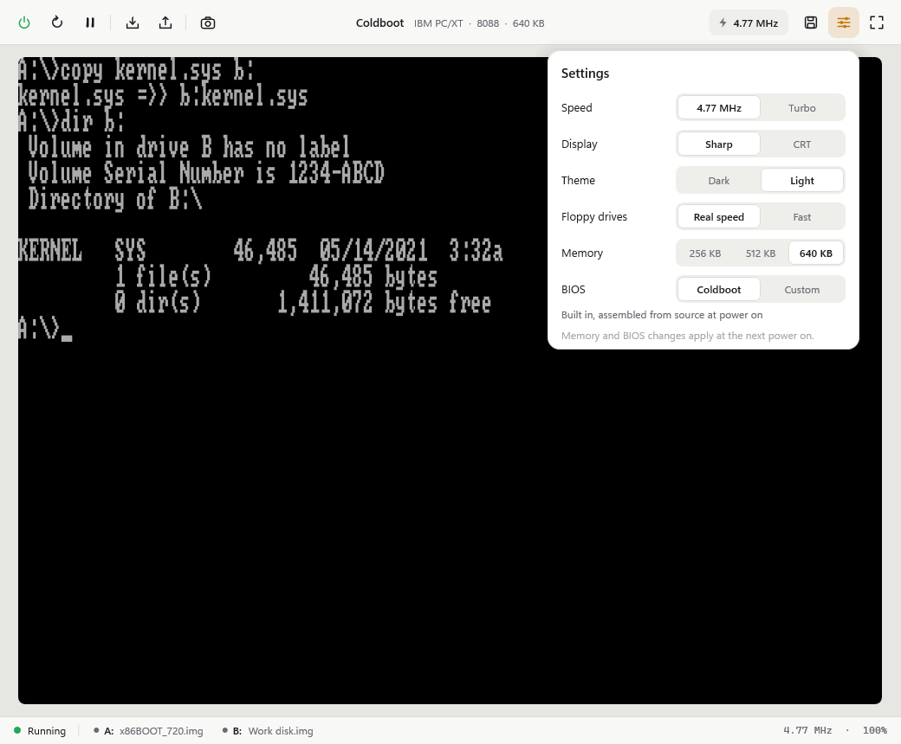
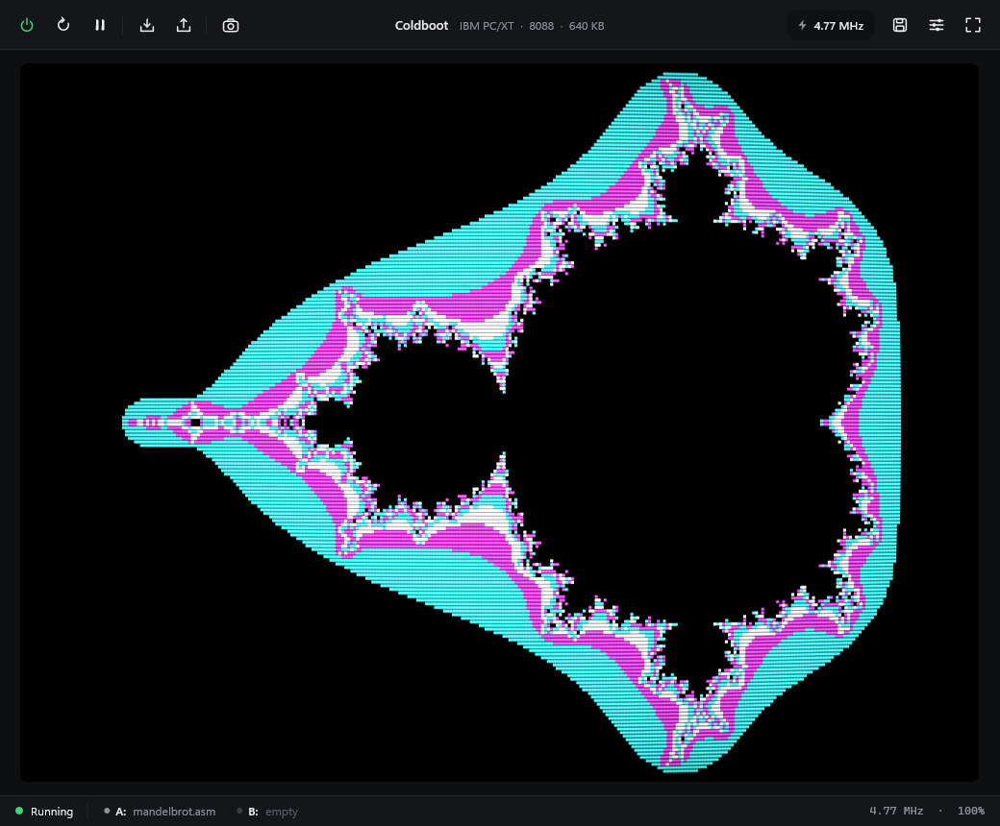

<p align="center">
  
</p>

<h1 align="center">Coldboot</h1>

<p align="center">
  IBM PC/XT emulator for Windows. The 8088, the chipset, the floppy controller, the BIOS and the assembler that builds the BIOS are all written from scratch, and nothing links against the C runtime.
</p>



## What's in it

Coldboot powers on into its own BIOS, which it assembles from source every time the machine starts. Drop a floppy image on the window and it boots. FreeDOS 1.3 runs on it, installer and all.

- **8088.** Every opcode, including the undocumented ones. Passes all 3,007,000 cases in [SingleStepTests 8088](https://github.com/SingleStepTests/8088), undefined flags included, and counts clocks with a prefetch queue model.
- **Board.** 8259, 8253, 8237 with DRAM refresh, 8255 with the configuration switches, the XT keyboard, the PC speaker, and CGA in all of its text and graphics modes.
- **Floppies.** An NEC 765 on DMA channel 2 and IRQ 6 with two drives and images from 160 KB to 1.44 MB. Writes go back to the image file when the drive motor stops.
- **BIOS.** About 3,100 lines of 8086 assembly in [`src/firmware`](src/firmware). POST with a memory count you can watch, a boot menu, INT 10h video for every CGA mode, the keyboard with every shift and lock key, INT 13h with media detection, the timer, and the IBM entry points at their fixed addresses.
- **Assembler.** A two-pass 8086 assembler with labels, local labels, `equ`, `org`, `times`, `incbin` and automatic short and near jumps. It builds the BIOS, the boot sector of every blank disk Coldboot makes, and any program you drop on the window.
- **Boot your own code.** Drop an `.asm` file on the window and Coldboot assembles it onto a 360 KB disk and reboots into it. Save the file and it rebuilds and reboots again, or shows the line it broke on and keeps the old build running. [`demos/mandelbrot.asm`](demos/mandelbrot.asm) draws the Mandelbrot set in CGA with 4.12 fixed point math in a single 512 byte boot sector, and takes about a minute at 4.77 MHz.
- **Save states.** The whole machine, disks included, in one file.
- **Display.** Direct3D 11 with sharp scaling to 4:3, or a CRT mode with curvature, scanlines and a phosphor mask. The interface is drawn with Direct2D and DirectWrite.



| | |
|---|---|
|  |  |
|  |  |



## Using it

- Coldboot opens on its machine list. **New** makes a machine in `Documents\Coldboot VMs`, each in its own folder with a `.coldboot` file you can copy, back up or add on another PC with **Add an existing machine**.
- **Start** (or a double click) opens the machine in its own window and process, so a crash in one machine never takes down the list or the others. The list shows which machines are running, and the last screen of each one after it closes.
- **Settings** changes the name, memory, floppies and BIOS while a machine is off. **Remove** either forgets a machine or moves its folder to the Recycle Bin.
- A machine window starts powered on. Drop a floppy image anywhere on it to put it in drive A, or hold Shift for drive B.
- Drop an `.asm` file the same way to boot it. Programs start at `org 0x7C00`, and anything that fits in one sector gets its boot signature added for you. A key press in the Mandelbrot demo cycles the CGA palettes.
- Press Esc while POST shows the hint to pick the boot drive.
- Click the screen to capture the keyboard, so Alt+Tab and the Windows key stay inside. Right Ctrl lets go.
- F11 is fullscreen, F12 saves a screenshot to `Pictures\Coldboot`, and Pause stops the clock.
- The pill next to the floppy button switches between a real 4.77 MHz and turbo, which runs as fast as your CPU allows.
- The floppy panel inserts, ejects and write-protects disks, and makes blank FAT12 disks from 360 KB to 1.44 MB.
- Settings cover speed, sharp or CRT display, a theme that follows Windows or stays dark or light, real or fast floppy timing, memory size, and Coldboot's BIOS or a ROM of your own.

To try it, get the [FreeDOS 1.3 Floppy Edition](https://www.freedos.org/download/) and drop `x86BOOT.img` from the `720k` folder on the window.

## Building

Needs Visual Studio 2022 with the C++ desktop workload and the Clang tools. Open `coldboot.sln` and build x64, or run:

```
msbuild coldboot.sln -p:Configuration=Release -p:Platform=x64
```

The exe ends up in `build\release`.

## Testing

Debug builds have extra modes, and none of them show a window.

```
Coldboot.exe --test
Coldboot.exe --cpu <folder with the 8088 v2 .json.gz files>
Coldboot.exe --own [--a <image>] [--b <image>] <steps>
Coldboot.exe --smoke <folder> [<image> | --vm <machine file>]
Coldboot.exe --smoke-manager <folder>
```

- `--test` runs 136 checks across the CPU, the chips, the floppy controller, the assembler, disk images, the BIOS, save states, the x86-64 instruction emulator and the hypervisor engine. The hypervisor checks are skipped on PCs without the Windows Hypervisor Platform.
- `--cpu` runs SingleStepTests. It also takes `--only <prefix>`, `--exact` and `--timing`.
- `--own` boots the built-in BIOS and works through the steps in order. `--a` and `--b` take `.asm` files too:
  - `--run <seconds>` runs emulated time
  - `--type <text>` types on the keyboard, where `\n` is Enter, and `--key <hex>` presses one scan code
  - `--print` writes the text screen to the console and `--shot <png>` saves it as an image
  - `--ui <png>` renders the whole app offscreen, with `--ui-light`, `--ui-crt` and `--ui-panel disks` or `settings` to pick the look
  - `--where`, `--hunt` and `--trail` show where the CPU is and catch it running into empty memory
  - `--asm` assembles the BIOS and reports errors as `file.asm:line`
- `--smoke` starts a machine window hidden with the sound off and your settings left alone. It boots, opens the floppy panel, saves and loads a state, and writes screenshots from the swap chain plus a short report into the folder. Add `--vm <file>` to run a machine file the same way.
- `--smoke-manager <folder>` runs the machine list hidden against a library in that folder. It creates, edits, removes and re-adds a machine, checks the files on disk and the saved screen preview, and writes screenshots and a report.
- `--manager <png>` (after `--own`) renders the machine list offscreen, with `--manager-sheet new`, `settings` or `remove` and `--manager-empty`.

Every screenshot here came from `--own` and `--ui`.